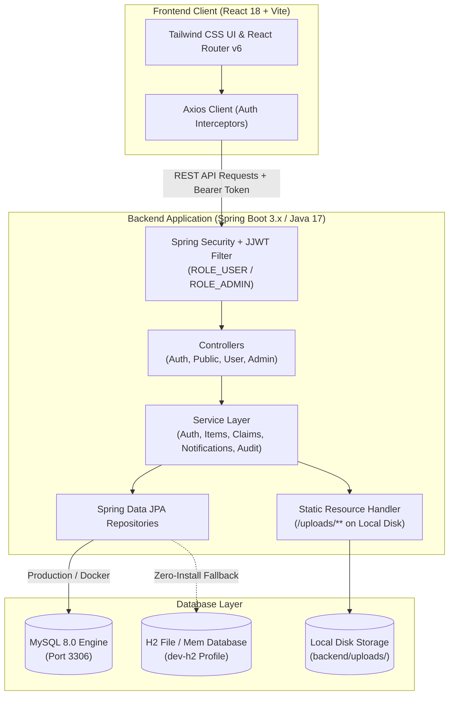
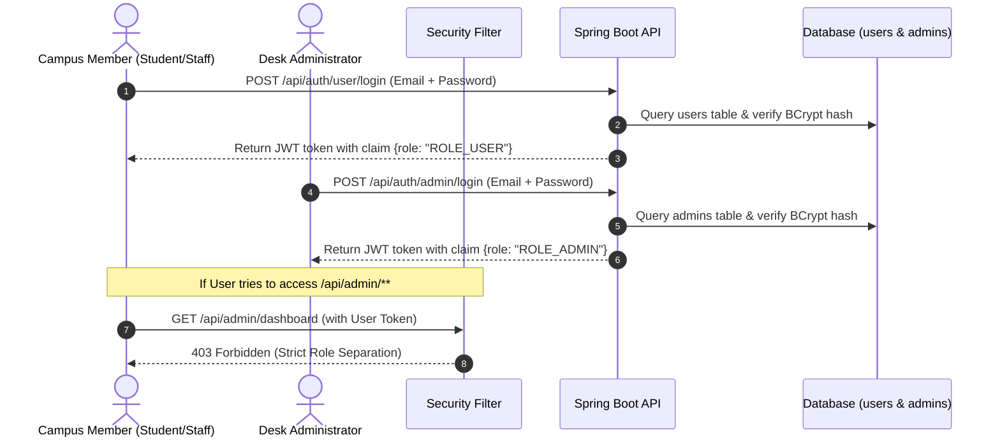
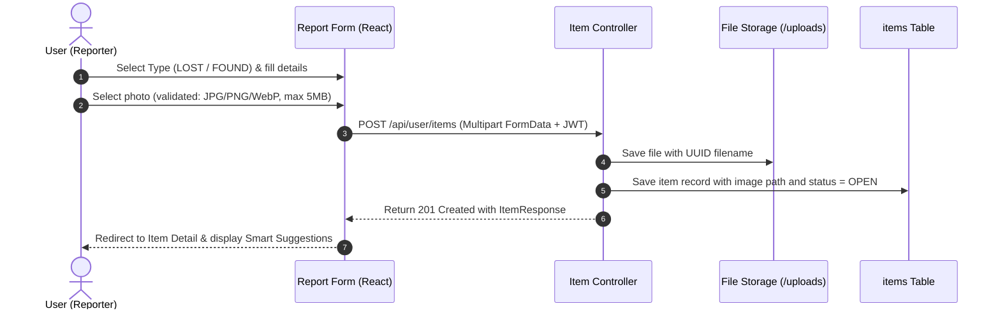
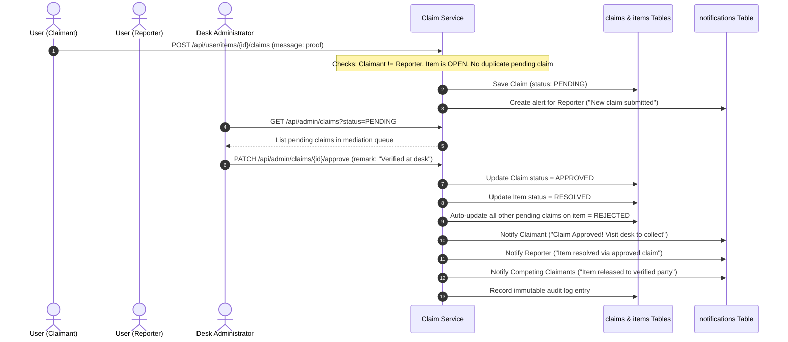

# Campus Lost & Found Portal

A complete, full-stack enterprise web portal designed for universities to streamline the reporting, tracking, matching, and mediated recovery of lost and found personal belongings on campus. The system provides two completely isolated portals: a public and student/staff member interface for reporting items and submitting ownership claims, and a dedicated desk administration interface for managing inventory, verifying claimant proofs, and overseeing handover compliance.

---

## 1. Feature Highlights

### Public & User Features (Students, Faculty, Staff)
- **Live Landing Page**: Hero section with quick actions, 3-step explanation of how the system works, and live counters for total items reported, items returned, and active members.
- **Role-Separated User Authentication**: Dedicated sign-up and sign-in pages with BCrypt password hashing and JWT access tokens.
- **Personalized Member Dashboard**: Real-time summary of filed reports, active claims, unread notifications, and quick action shortcuts.
- **Unified Report Item Flow**: Single form component with an intuitive type switch (`LOST` vs. `FOUND`), category, campus location, date, contact preference, and photo upload.
- **Interactive Directory with Search & Filters**: Live keyword search across titles and descriptions, multi-criteria filtering (Type, Category, Location, Date Range, Status), sorting (Newest/Oldest), and pagination.
- **Item Detail View**: High-resolution image preview or placeholder, complete metadata, and reporter information.
- **Smart Item Suggestions**: On LOST item pages, deterministic recommendation scoring surfaces up to 5 matching FOUND items based on category, date proximity, location, and keyword overlap.
- **Ownership Claim Submission**: Members can file claims on found items (or report finding lost items) with detailed proof descriptions for campus desk review. Server rules prevent claiming own items or submitting duplicate pending claims.
- **My Reports Management**: View, edit, soft-manage, and mark own reports as resolved, or delete them with confirmation.
- **My Claims Tracker**: Real-time status tracking (Pending, Approved, Rejected) including administrative remarks and collection instructions.
- **In-App Notification Center**: Instant alerts when claims are approved, rejected, or filed on personal items. Features unread count badge, mark-as-read, and mark-all-as-read.
- **Member Profile & Security**: Update contact details and change password with current password verification.

### Administrator Features (Lost & Found Desk Staff)
- **Desk Telemetry Dashboard**: High-level KPI metric cards (Total Users, Total Items, Lost vs. Found, Pending Claims, Resolved Items), an interactive Recharts bar chart showing item distribution by category, and recent activity feeds.
- **Claims Mediation Queue**: Centralized desk queue to review claimant proof descriptions against reported items. Approving a claim marks the item as `RESOLVED`, automatically rejects competing pending claims on that item, and dispatches collection notifications to all affected users.
- **User Account Management**: Search registered members by name, email, or department with pagination. Administrative suspension (block) and reinstatement (unblock) prevent compromised accounts from logging in.
- **Inventory Control**: Comprehensive inventory table with filters; soft delete items with mandatory administrative reason notes, restore removed items, or mark items resolved.
- **Taxonomy Management**: Full CRUD interface for Categories and Campus Locations with server-side in-use protection (prevents deleting categories or locations currently assigned to items).
- **Immutable Audit Trail**: Compliance journal recording administrative events (`CLAIM_APPROVED`, `ITEM_REMOVED`, `USER_BLOCKED`, etc.) with timestamps, acting admin email, and contextual details.
- **Admin Profile & Password Management**: Profile updating and password security controls.

---

## 2. Tech Stack

| Layer | Technology | Purpose |
| :--- | :--- | :--- |
| **Backend Framework** | Java 17, Spring Boot 3.2.x | Enterprise RESTful API services and business logic |
| **Security & Auth** | Spring Security 6, JJWT 0.12.5, BCrypt | Stateless JWT authentication, role guards, password hashing |
| **Data Persistence** | Spring Data JPA, Hibernate 6 | Relational database ORM, specifications, and queries |
| **Databases** | MySQL 8.0 (Default) / H2 (Zero-install dev profile) | Production relational storage and portable in-memory testing |
| **API Documentation** | springdoc-openapi 2.5 (Swagger UI) | Interactive OpenAPI 3 endpoint documentation |
| **Frontend Framework** | React 18, Vite 5 | Reactive Single Page Application (SPA) |
| **Routing** | React Router v6 | Client-side routing with role-based route guards |
| **Styling & Icons** | Tailwind CSS 3, Lucide React | Modern responsive design system and SVG iconography |
| **HTTP Client** | Axios | Request/response interceptors with automatic JWT injection |
| **Notifications** | react-hot-toast | Non-blocking toast feedback for all interactions |
| **Data Visualization** | Recharts 2 | Responsive administrative inventory analytics chart |
| **Containerization** | Docker, Docker Compose | Single-command MySQL 8 database service |

---

## 3. System Architecture



### ASCII Architecture Fallback
```
+-----------------------------------------------------------------------+
|                       FRONTEND: React 18 + Vite                       |
|   (Public Landing, Browse, User Portal, Desk Admin Portal, Tailwind)  |
+-----------------------------------------------------------------------+
                                  |
                   HTTP / REST API + JWT Bearer Token
                                  v
+-----------------------------------------------------------------------+
|                    BACKEND: Spring Boot 3.x (Java 17)                 |
|                                                                       |
|  [Spring Security Filter] -> Validates JWT (ROLE_USER / ROLE_ADMIN)   |
|            |                                                          |
|  [REST Controllers]       -> Auth, Public, User, Admin Endpoints      |
|            |                                                          |
|  [Service Layer]          -> Business Rules, Mediation, Suggestions   |
|            |                                                          |
|  [JPA Repositories]       -> Data Access & Relational Mappings        |
+-----------------------------------------------------------------------+
         |                                          |
         v                                          v
+-----------------------+              +--------------------------------+
|  DATABASE (MySQL 8)   |              |  LOCAL DISK: backend/uploads/  |
|  (Or fallback H2 DB)  |              |  (Uploaded Item Photos)        |
+-----------------------+              +--------------------------------+
```

---

## 4. How the System Works

### A. Authentication & Role Separation Flow
User and Admin accounts live in completely independent database tables (`users` vs. `admins`), utilize distinct authentication endpoints, generate separate JWT role claims (`ROLE_USER` vs. `ROLE_ADMIN`), and are guarded by isolated frontend login pages.



- **Admin Invite Code**: Administrator sign-up strictly requires the secret `ADMIN_INVITE_CODE` (`CAMPUS_ADMIN_2026`). Without the matching code, registration is rejected with HTTP 400.
- **Account Blocking**: When an administrator suspends a user, subsequent login attempts are rejected with HTTP 403: *"Your account has been suspended by administration."*

---

### B. Reporting an Item Flow


---

### C. Claim -> Admin Approval -> Item Resolved Flow


---

### D. Smart Suggestions Algorithm
When viewing a reported **LOST** item, the portal automatically computes recommendation scores against all active **FOUND** items in the directory to help find candidate matches instantly:

```
Total Match Score = Base Category Score (50 pts)
                  + Location Match Bonus (20 pts)
                  + Date Proximity Bonus (up to 30 pts)
                  + Keyword Overlap Bonus (up to 50 pts)
```

1. **Category Filter**: Candidates must share the same category (e.g., *Electronics*). This grants **+50 points**.
2. **Location Match**: If found at the exact same campus landmark (e.g., *Main Library*), grants **+20 points**.
3. **Date Proximity**:
   - Within 3 days of loss: **+30 points**
   - Within 7 days of loss: **+20 points**
   - Within 14 days of loss: **+10 points**
4. **Keyword Overlap**: Titles and descriptions are tokenized into non-stopword keywords ($\ge 4$ characters). Each common keyword grants **+10 points** (capped at 50 points).
5. **Deterministic Ordering**: Top 5 candidate items are ranked by `matchScore DESC` and `eventDate DESC`.

---

## 5. Database Overview

Refer to [`database/ER-diagram.md`](database/ER-diagram.md) and [`database/DATABASE.md`](database/DATABASE.md) for full relational constraints, types, and schema specifications.

| Table Name | Primary Purpose |
| :--- | :--- |
| **`users`** | Stores student and staff accounts (passwords hashed with BCrypt, suspension flag `is_blocked`). |
| **`admins`** | Completely isolated table for campus desk administrators. Never shares records with `users`. |
| **`categories`** | Standard classifications (Electronics, ID/Cards, Wallets, Bags, Keys, Books, Clothing, Others). |
| **`locations`** | Standard campus landmarks and zones (Library, Main Gate, Canteen, Hostels, Labs, etc.). |
| **`items`** | Main inventory of Lost and Found reports with type, dates, photos, and lifecycle status (`OPEN`, `RESOLVED`, `REMOVED`). |
| **`claims`** | Ownership assertions submitted by users and mediated by desk administrators (`PENDING`, `APPROVED`, `REJECTED`). |
| **`notifications`** | In-app alerts informing users of claim decisions, competing resolutions, and administrative updates. |
| **`audit_logs`** | Immutable journal of administrative moderation actions, approvals, and user suspensions. |

---

## 6. Folder Structure

```
campus-lost-and-found/
├── backend/
│   ├── pom.xml                               # Maven project descriptor
│   ├── .env.example                          # Environment template for backend
│   ├── uploads/
│   │   └── .gitkeep                          # Local disk storage for uploaded item images
│   └── src/
│       ├── main/
│       │   ├── java/com/campus/lostandfound/
│       │   │   ├── CampusLostAndFoundApplication.java
│       │   │   ├── config/                   # SecurityConfig, WebMvcConfig, OpenApiConfig, DatabaseSeeder
│       │   │   ├── controller/               # Auth, Public, User, and Admin REST controllers
│       │   │   ├── dto/                      # Data Transfer Objects (auth, item, claim, user, dashboard)
│       │   │   ├── entity/                   # JPA Entities (User, Admin, Item, Claim, Notification, AuditLog)
│       │   │   ├── exception/                # GlobalExceptionHandler, Custom RuntimeExceptions
│       │   │   ├── repository/               # Spring Data JPA repositories & specifications
│       │   │   ├── security/                 # JwtTokenProvider, UserPrincipal, JwtAuthenticationFilter
│       │   │   └── service/                  # Business logic services & file management
│       │   └── resources/
│       │       ├── application.properties    # Default MySQL profile configuration
│       │       └── application-dev-h2.properties # Zero-install H2 profile configuration
│       └── test/java/com/campus/lostandfound/
│           ├── AuthServiceTest.java          # JUnit tests for user & admin authentication rules
│           ├── ItemBusinessRulesTest.java    # JUnit tests for business logic & claim restrictions
│           └── ApplicationIntegrationTest.java # SpringBootTest validating startup & seeding
├── frontend/
│   ├── package.json                          # Vite + React dependencies
│   ├── vite.config.js                        # Vite configuration
│   ├── tailwind.config.js                    # Tailwind CSS configuration
│   ├── index.html                            # HTML entrypoint
│   ├── .env.example                          # Environment template for frontend
│   └── src/
│       ├── main.jsx                          # React root with BrowserRouter & AuthProvider
│       ├── App.jsx                           # Application routing & toast provider
│       ├── index.css                         # Tailwind directives & global styling
│       ├── api/client.js                     # Axios instance with request/response JWT interceptors
│       ├── context/AuthContext.jsx           # Separate user & admin auth state and token storage
│       ├── components/common/                # Navbar, Footer, StatusBadge, StatCard, ItemCard, Modals
│       ├── layouts/                          # PublicLayout, UserLayout, AdminLayout
│       └── pages/
│           ├── public/                       # LandingPage, BrowsePage, Login, Register, AdminLogin, AdminRegister, 404
│           ├── user/                         # UserDashboard, ReportItem, ItemDetail, MyItems, MyClaims, Notifications, Profile
│           └── admin/                        # AdminDashboard, ClaimsQueue, ManageItems, ManageUsers, CategoriesLocations, AuditLogs, AdminProfile
├── database/
│   ├── schema.sql                            # DDL script creating all 8 tables and indexes
│   ├── seed.sql                              # Initial realistic sample data
│   ├── docker-compose.yml                    # Starts MySQL 8 container with automatic schema & seed init
│   ├── ER-diagram.md                         # Visual Mermaid Entity Relationship diagram
│   └── DATABASE.md                           # Comprehensive database dictionary and table documentation
├── test_e2e_verification.py                  # Automated 45-point end-to-end verification script
├── README.md                                 # Beginner-friendly guide and documentation
└── .gitignore
```

---

## 7. Prerequisites

Before running the application, make sure your machine has:
1. **Java JDK 17 or higher** (`java -version`)
2. **Apache Maven 3.8+** (`mvn -version`)
3. **Node.js 18+ and npm 9+** (`node -v` and `npm -v`)
4. **MySQL 8.0** installed locally **OR** **Docker** (optional, for `docker-compose`)

---

## 8. Step-by-Step Run Guide

Choose **Option 1 (Zero-Install H2)** for immediate demonstration without installing any database, or **Option 2 (MySQL via Docker or Native MySQL)**.

### Option 1: Zero-Install Quick Start (Recommended for instant testing)
Runs the entire full-stack system locally in 3 terminal tabs using the embedded file-based H2 database.

#### Step 1: Start Backend (Terminal 1)
```bash
cd campus-lost-and-found/backend
mvn spring-boot:run -Dspring-boot.run.profiles=dev-h2
```
*The backend will automatically start on `http://localhost:8080`, generate the database files, and seed all sample records.*

#### Step 2: Start Frontend (Terminal 2)
```bash
cd campus-lost-and-found/frontend
npm install
npm run dev
```
*The frontend will start on `http://localhost:5173`.*

---

### Option 2: Running with MySQL 8

#### A. Start MySQL Database
**Using Docker Compose:**
```bash
cd campus-lost-and-found/database
docker compose up -d
```

**Or using Local MySQL 8:**
```bash
mysql -u root -p < campus-lost-and-found/database/schema.sql
mysql -u root -p campus_lost_found < campus-lost-and-found/database/seed.sql
```

#### B. Start Backend
```bash
cd campus-lost-and-found/backend
mvn spring-boot:run
```

#### C. Start Frontend
```bash
cd campus-lost-and-found/frontend
npm install
npm run dev
```

---

### Access URLs
- **Frontend Portal**: [http://localhost:5173](http://localhost:5173)
- **Backend API Base**: [http://localhost:8080](http://localhost:8080)
- **Interactive Swagger UI**: [http://localhost:8080/swagger-ui.html](http://localhost:8080/swagger-ui.html)
- **OpenAPI 3 JSON Spec**: [http://localhost:8080/v3/api-docs](http://localhost:8080/v3/api-docs)
- **H2 Web Console** (in `dev-h2` mode): [http://localhost:8080/h2-console](http://localhost:8080/h2-console) *(JDBC URL: `jdbc:h2:file:./data/campusdb`, User: `sa`, Password: blank)*

---

## 9. Environment Variables

| Variable | Default Value | Description |
| :--- | :--- | :--- |
| `PORT` | `8080` | Backend HTTP server port |
| `DB_URL` | `jdbc:mysql://localhost:3306/campus_lost_found?...` | JDBC connection string |
| `DB_USERNAME` | `campus_user` | Database username |
| `DB_PASSWORD` | `campus_password` | Database password |
| `DDL_AUTO` | `validate` | Hibernate DDL strategy (`validate` for MySQL, `update` for H2) |
| `JWT_SECRET` | `404E635266556A586E3272357538782F413F4428472B4B6250645367566B5970` | 256-bit secret key for HMAC-SHA256 JWT signing |
| `JWT_EXPIRATION_MS` | `86400000` | Token validity duration in milliseconds (24 hours) |
| `ADMIN_INVITE_CODE`| `CAMPUS_ADMIN_2026` | Mandatory registration code required to create new desk admin accounts |
| `ALLOWED_EMAIL_DOMAIN` | *(blank)* | Optional restriction to university email domains (e.g. `campus.edu`) |
| `UPLOAD_DIR` | `uploads` | Local disk directory where uploaded item photos are stored |
| `CORS_ALLOWED_ORIGINS`| `http://localhost:5173,http://localhost:3000` | Permitted client origin URLs |
| `VITE_API_BASE_URL`| `http://localhost:8080` | Base URL used by the React frontend to reach the backend API |

---

## 10. Default Credentials

The database automatically seeds these pre-configured accounts on initial launch:

| Role | Name | Email | Password | Extra Note |
| :--- | :--- | :--- | :--- | :--- |
| **Desk Admin** | Campus Desk Admin | `admin@campus.edu` | `AdminPassword123!` | System Administrator |
| **User (Student)** | Alice Smith | `alice@campus.edu` | `UserPassword123!` | CS Department |
| **User (Student)** | Bob Johnson | `bob@campus.edu` | `UserPassword123!` | Mechanical Engineering |
| **User (Student)** | Charlie Davis | `charlie@campus.edu` | `UserPassword123!` | Electrical Engineering |

> **Admin Invite Code for creating new desk admins**: `CAMPUS_ADMIN_2026`

---

## 11. REST API Endpoints

### Authentication (`/api/auth`)
- `POST /api/auth/user/register` — Register a student/staff account
- `POST /api/auth/user/login` — Sign in as a student/staff user
- `POST /api/auth/admin/register` — Register a desk administrator (requires `inviteCode`)
- `POST /api/auth/admin/login` — Sign in as a desk administrator

### Public Endpoints (`/api/public`)
- `GET /api/public/stats` — Live counters (total reports, reunited items, active members)
- `GET /api/public/categories` — List active item categories
- `GET /api/public/locations` — List campus landmark locations

### User Endpoints (`/api/user/**` — requires `ROLE_USER`)
- `GET /api/user/dashboard` — Personal summary statistics and recent reports/claims
- `GET /api/user/items` — Browse directory with search, filters, and pagination
- `GET /api/user/items/{id}` — Retrieve item details
- `POST /api/user/items` — Report a Lost or Found item (Multipart FormData with optional photo)
- `PUT /api/user/items/{id}` — Update own reported item
- `DELETE /api/user/items/{id}` — Delete own reported item
- `PATCH /api/user/items/{id}/resolve` — Mark own item as resolved
- `GET /api/user/items/mine` — List items reported by current authenticated user
- `GET /api/user/items/{id}/suggestions` — Get top 5 deterministic smart suggestions for a lost item
- `POST /api/user/items/{id}/claims` — Submit an ownership claim on an item
- `GET /api/user/claims/mine` — List ownership claims submitted by current user
- `GET /api/user/notifications` — List in-app notifications
- `PATCH /api/user/notifications/{id}/read` — Mark a single notification as read
- `PATCH /api/user/notifications/read-all` — Mark all notifications as read
- `GET /api/user/notifications/unread-count` — Count unread notifications
- `GET /api/user/profile` — Fetch current user profile
- `PUT /api/user/profile` — Update name, department, or phone
- `PUT /api/user/change-password` — Change password (requires current password verification)

### Admin Endpoints (`/api/admin/**` — requires `ROLE_ADMIN`)
- `GET /api/admin/dashboard` — KPI cards, Recharts category analytics, recent queue feeds
- `GET /api/admin/users` — Search and list campus users with pagination
- `PATCH /api/admin/users/{id}/block` — Suspend a user account
- `PATCH /api/admin/users/{id}/unblock` — Reinstate a suspended user account
- `GET /api/admin/items` — Browse and filter all items (including REMOVED)
- `PATCH /api/admin/items/{id}/remove` — Soft-delete item with mandatory reason note
- `PATCH /api/admin/items/{id}/restore` — Restore soft-deleted item to active OPEN status
- `PATCH /api/admin/items/{id}/resolve` — Mark item as resolved
- `GET /api/admin/claims` — List claims queue with status filter
- `PATCH /api/admin/claims/{id}/approve` — Approve claim (resolves item, auto-rejects competing claims, notifies all parties)
- `PATCH /api/admin/claims/{id}/reject` — Reject claim with administrative remark
- `GET /api/admin/categories` & `POST /api/admin/categories` — List & create categories
- `PUT /api/admin/categories/{id}` & `DELETE /api/admin/categories/{id}` — Update & delete category (with in-use protection)
- `GET /api/admin/locations` & `POST /api/admin/locations` — List & create locations
- `PUT /api/admin/locations/{id}` & `DELETE /api/admin/locations/{id}` — Update & delete location (with in-use protection)
- `GET /api/admin/audit-logs` — Paginated immutable compliance audit journal
- `GET /api/admin/profile` & `PUT /api/admin/profile` — View & update admin name
- `PUT /api/admin/change-password` — Change administrator password

---

## 12. 10-Step Live Demonstration Script

Follow this step-by-step sequence to showcase every feature during project evaluation:

1. **Public Landing Experience**: Open `http://localhost:5173/`. Point out the live university metrics (12+ items reported, items returned, active users), the 3-step explanation cards, and recent items.
2. **Student Login**: Click **Log In** and sign in as Alice (`alice@campus.edu` / `UserPassword123!`). View her dashboard with stats, recent reports, and claim history.
3. **Directory Search & Smart Suggestions**:
   - Go to **Browse** and filter by Type: **Lost**, Category: **Electronics**.
   - Click on the *Sony Headphones* report. Notice the **Smart Matches** section at the bottom showing candidate found headphones with percentage match scores and breakdown explanations!
4. **Filing a Claim with Ownership Proof**:
   - Log out, then log in as Bob (`bob@campus.edu` / `UserPassword123!`).
   - Find item #4 (*Black 65W USB-C Power Adapter* reported by Alice). Click **Claim This Item**.
   - Enter detailed proof: *"Has my initials 'BJ' written in silver sharpie on the back prong."* Submit claim.
5. **Business Rule Enforcement**:
   - Try claiming item #4 a second time: the portal immediately warns that a pending claim already exists.
   - Go to Bob's own reported item and try claiming it: the portal prohibits claiming one's own item.
6. **Reporting a New Found Item with Photo**:
   - Click **Report Item**. Switch the toggle to **I Found Something**.
   - Title: *"Found Graphing Calculator in Library"*, Category: *Electronics*, Location: *Main Library*, upload an image.
   - Click submit and verify the item appears immediately in the directory with photo served from disk.
7. **Desk Administrator Mediation (Claims Queue)**:
   - Sign out, and visit `http://localhost:5173/admin/login`.
   - Sign in as Admin (`admin@campus.edu` / `AdminPassword123!`).
   - Examine the **Admin Dashboard** with the Recharts bar chart showing item counts per category.
   - Navigate to **Claims Queue**. Click **Approve** on Bob's claim. Enter desk remark: *"Verified serial number in person at desk. Handed over."*
   - Notice the item status automatically transitions to **RESOLVED**, competing claims are auto-rejected, and an audit log entry is recorded!
8. **User Notifications Verification**:
   - Sign out of Admin and log back in as Bob (`bob@campus.edu` / `UserPassword123!`).
   - Notice the **Notification Bell** in the top navbar displaying unread count `1`.
   - Open notifications to see the official desk collection notice with the admin's remark.
9. **Admin Moderation & Security**:
   - Log back into Admin (`admin@campus.edu`).
   - Go to **Manage Users**. Suspend an abusive or test account by clicking **Suspend**.
   - Attempt to log in with that user in an incognito window: observe the clear suspension notice. Return to Admin and click **Unblock** to reinstate.
   - Go to **Manage Items** and test soft-delete with an administrative removal reason note.
10. **Taxonomy & Audit Trail**:
    - Open **Categories & Locations**. Try deleting *Electronics* (assigned to items): observe the server safely rejects deletion. Create a new test location and delete it cleanly.
    - Open **Audit Logs** and demonstrate the immutable record of all approved claims, suspensions, and removals.

---

## 13. Troubleshooting

- **Port 8080 already in use**:
  ```bash
  lsof -i :8080
  kill -9 <PID>
  # Or run backend on a different port:
  PORT=8081 mvn spring-boot:run -Dspring-boot.run.profiles=dev-h2
  ```
- **Port 5173 already in use**:
  ```bash
  cd frontend && npm run dev -- --port 5174
  ```
- **Database Connection Refused**:
  If MySQL is not installed or running, launch with the zero-install H2 profile:
  ```bash
  mvn spring-boot:run -Dspring-boot.run.profiles=dev-h2
  ```
- **File Upload Errors (Exceeds 5MB)**:
  Ensure uploaded images are valid `.jpg`, `.png`, or `.webp` files under 5 MB.
- **Java Version Issues**:
  The project requires JDK 17+. Verify your Java runtime with `java -version`.

---

## 14. Assumptions & Decisions

1. **Role Separation**: Administrators and students/staff do not share a single `users` table or role column. Separate `users` and `admins` tables ensure complete identity isolation and eliminate privilege escalation risks.
2. **Mediation Model**: To prevent fraud or on-campus theft, items are not released peer-to-peer; the campus lost-and-found desk acts as the central verification authority for every claim.
3. **Soft Deletion**: Removed items are marked as `REMOVED` with an explanatory reason rather than being permanently erased, maintaining complete historical integrity and audit compliance.
4. **Local Disk Photo Storage**: Uploaded files are stored in `backend/uploads/` using UUID filenames to prevent collisions and directory traversal attacks, and served statically by Spring WebMvc.
5. **Deterministic Suggestions**: Recommendation scoring relies on deterministic lexical and temporal rules rather than opaque external AI services, ensuring consistent, repeatable behavior across all platforms.
